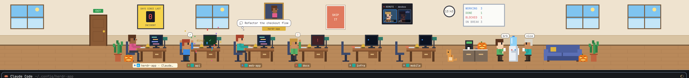

# Office for Herdr

A [Herdr](https://herdr.dev) layout with a pixel-art office above your terminals. Every coding agent is a coworker. They type at their desks while working, hang out at the water cooler when idle, nap on the couch, raise a hand when blocked, and cheer in confetti when done. Sub-agents show up as interns, remote agents join by video call, and a cat naps on empty keyboards.

## Install

Ask the agent in your Herdr window:

> Add the layout herdr.dev/layouts/DustyPolk/herdr-office

Or by hand:

1. Copy `layouts/office.json` and `layouts/office.svg` into `~/.config/herdr-app/layouts/`.
2. Copy `mods/office/` into `~/.config/herdr-app/mods/`.
3. Merge `keys.json` into your `~/.config/herdr-app/keys.json`. It adds `ctrl-shift-i` to hide or show the office strip, only while this layout is shown.
4. Run `herdr-app check ~/.config/herdr-app/mods/office`, then `herdr-app do layout.switch --name office`.

`ctrl-shift-l` switches back to your previous layout.

## Weather

The windows can show your real weather. It's off by default because it sends your IP address to `ipapi.co` for a rough location, then asks Open-Meteo for the current conditions. To turn it on, set `const WEATHER = true;` at the top of `mods/office/main.js`. Nothing else contacts the network, and the mod runs no programs.

See [RECIPE.md](RECIPE.md) for everything it does and how it's built.

## License

MIT. Do whatever you like with it.
