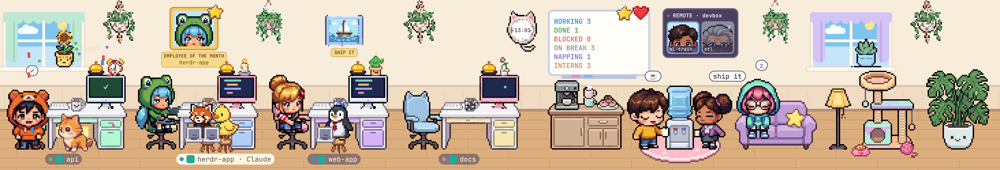

# Office

A cozy pixel-art office strip above your terminals where every coding agent is a little chibi coworker. Working agents type at their desks. Idle ones wander to the water cooler to chat, and nap on the couch if they stay idle. Blocked agents wave for help. Finished ones cheer in confetti until you look. Sub-agents are tiny animals in neckties. A cat lives there too. Click anyone to jump to their terminal.

## What you see

The window is Herdr's default arrangement with one strip added. From top to bottom on the right:

- **Tab bar**, 42px (Herdr's `tabs`).
- **The office**, a strip 250px tall by default (resizable from 170 to 520px).
- **The active tab's terminals**, with the Files and Changes panel on the right.
- **Status bar**, 28px.

On the left is Herdr's sidebar, with the spaces list only. The agents list is gone because the office shows the agents.

The office is drawn with pixel-art sprites: soft pastel furniture with dark outlines, chibi coworkers, a cat. One art unit is `P` px and one sprite pixel is half a unit: `P` is 3 below 210px of strip height, 4 up to 330px and 6 above, so a sprite pixel is a whole 2px or 3px on screen except in the shortest strip. The floor line sits 30px above the strip's bottom edge.

- **Wall.** Cream `#f8ecdb`, with a wainscot band `#f0dcc2` 9 units tall (thin slats every 28px) and a baseboard `#b8906e`. Along it run, left to right over the room:
  - windows 120px wide with white trim, pastel curtains and a potted flower on the sill
  - a framed picture every fifth slot; half of them have a brass plate ("SHIP IT" under the sailboat, "LGTM" under the rocket, "BE KIND TO YOUR AGENTS" under the heart, "push --force? no." under the rubber duck)
  - plants hanging from the ceiling between the slots
  - a yellow **DAYS SINCE LAST INCIDENT** sign
  - an **EMPLOYEE OF THE MONTH** portrait in a gold frame
  - a **REMOTE** video-call screen (only when agents run on another machine)
  - a cat-shaped wall clock showing the real time
  - a whiteboard counting WORKING, DONE, BLOCKED and ON BREAK, plus NAPPING, INTERNS and PIZZA!! when they apply
- **Floor.** Wood `#dcae7e` with plank lines `#cb9c6c`. A robot vacuum does slow laps along the baseboard behind the desks.
- **Room layout**, left to right and centered in the strip:
  - a wooden **door** with a porthole under a green EXIT sign, and an umbrella stand
  - a fiddle-leaf fig
  - a row of **desks**, 48 units apart, each with its chair on the left
  - the kitchen: a counter with a steaming coffee machine, mugs and donuts; a water cooler on a round pink rug; a lavender couch
  - a floor lamp, a cat tree with a food bowl and a ball of yarn, and a monstera with a face on its pot

  When the strip is too narrow, the umbrella stand, the lamp and the cat tree go, in that order. When it's wider than the room, the wall on either side fills with furniture and more windows, alternating: a bookshelf, a fish tank, a claw machine, a vending machine, a fridge, an arcade cabinet and so on.
- **Desks.** At least 3. Past 6 agents, a second row appears half a slot over and 10 units further back. Desks come in six colors, and the cat-eared swivel chairs in four. Each desk has:
  - a monitor with a gold desk bell and a small toy on top (a duck, a succulent, a robot…)
  - a keyboard, and a mug with a face, colored by the agent's program: Claude `#d97757`, Codex `#e8e8e8`, Gemini `#4f86f7`, Cursor `#4a4a55`, OpenCode `#58b368`, Amp `#9b6bdc`
  - a yellow sticky note on the desk front with the pane's git branch
  - a nameplate below with a status dot, the space's color tile, and "space · tab"
- **People.** Eight coworkers: Berry, Biscuit, Jazz, Kuma, Mochi, Plum, Pops and Ribbit. Each agent is one of them, picked by its terminal address; when that coworker is already in, it gets the next one who isn't.
- **The window sky** follows the hour: dawn, day, sunset, and night with stars and a moon.

## How it behaves

- **working.** Sits in the chair at their desk, knees bent and feet off the floor, typing, turned a little toward you. Colored code lines grow and shrink on the screen.
- **idle.** Gets up and walks to the water cooler, sipping from a paper cup. Speech bubbles cycle through small talk ("lgtm", "standup?", "🍩", "tabs > spaces"…). Their empty monitor shows a drifting screensaver dot.
  - **Napping.** After 10 minutes idle, they move to the couch (up to 2 at a time) with eyes closed and "zZz".
- **blocked.** Stands up at the desk and waves a hand over their head with a blinking "!" bubble. The screen turns red with a "!".
  - **Fire alarm.** After 5 minutes blocked, a red siren flashes over that desk, the whole room pulses red, and the agent bounces, yelling "HELP!!".
- **done.** Stands up and jumps with both arms up and a ✓ bubble. The screen turns green, the desk bell wiggles with "ding!", and confetti falls over the desk until you look. Then the agent turns idle and walks to the cooler.
- **Walking.** Walkers slide between spots at 0.16 px/ms with a walk cycle, facing the way they move. They walk in front of the furniture and settle into their chair when they arrive.
- **Arrivals and departures.** A new agent walks in through the door to its desk. A closed agent walks out carrying a cardboard box with a plant in it. The door shows open while someone passes through.
- **Interns.** Sub-agents (terminals an agent started with `hc run`) are small animals in neckties: a chick, a hedgehog, a red panda, 49 kinds in all, picked by terminal address. They sit on stools in front of their parent's desk, bobbing over a laptop while working. Up to 3 show, then "+N". A finished intern puts on a graduation cap, bows with "🎓 thx!", and hops out the door. Clicking an intern peeks at its terminal.
- **Remote agents.** Agents whose address has a machine prefix (`devbox/t3`) never come into the office. They appear as faces on the REMOTE video call:
  - blue border and head bob while working
  - red flashing "!" when blocked
  - green ✓ when done
  - dimmed with "zZz" when idle

  Clicking a tile goes to their terminal.
- **Overtime.** After 30 minutes of nonstop work, sweat drops fall from the head. After an hour, more mugs pile up on the desk.
- **Hover.** Hovering a person shows a 💭 thought cloud with their terminal title.
- **Click.** Clicking a person or their desk focuses their pane. The focused agent's nameplate turns cream.
- **Pizza party.** When 3 agents finish within 5 minutes, a courier in a red cap walks in with a pizza, leaves it on the counter and walks out. For 8 minutes, idle agents gather around the counter saying "🍕 nom", and nobody naps.
- **Incident sign.** Resets to a blinking red 0 whenever any agent is blocked, and counts days since otherwise. It's saved across restarts.
- **Employee of the Month.** The agent with the most completed turns.
- **The cat.** About every 9 seconds it may pick a new spot: it wanders the floor and sits, or jumps onto an empty desk and curls up to sleep ("zzz"). It hops off when that agent comes back.
- **Small things that move.** Fish swim in the tank, the claw machine's claw sways and its lights blink, steam rises from the coffee.
- **Night** (8pm to 6am). The room dims, the floor lamp glows, and busy monitors have a glow around them.
- **Seasons**, by date:
  - Oct 1 to Nov 7: jack-o'-lanterns by the fig, the couch and the monstera
  - December: a decorated tree in place of the fig and blinking string lights, with snow in the windows when weather is off
  - Dec 31 to Jan 2: a HAPPY NEW YEAR banner
  - Feb 14: a Valentine's banner
- **Weather** (off by default). The windows show rain, snow, clouds, fog or a storm, refreshed every 30 minutes.
- **`ctrl-shift-i`** hides or shows the office strip (only while this layout is shown).

## Built from

- **`layouts/office.json`.** Herdr's `main` tree with:
  - the `agents` block removed from the sidebar
  - a block `{ "id": "office", "size": { "px": 250 }, "min": 170, "max": 520, "content": { "mod": "office" } }` between `tabs` and `work-body`

  The shipped mods it uses are `workspace-chrome`, `spaces`, `tabs`, `files`, `changes` and `workspace-status`.
- **`mods/office/main.js`.** The scene and all behavior. It reads:
  - `agents()` for status, title, space, tab and pane
  - `terminals()` for sub-agents via `parent`, plus `turn` and `state`
  - `spaces()` for each tab's `changed_at` and `working_since`
  - `panes()` for branches
  - `shared("space.icons")` and `shared("space.colors")` for nameplate tiles

  It calls `setAgentOrder`, and runs `pane.focus` and `terminal.peek`. Motion is native only: `transition("left"/"top")` for walking, `loop` for bobbing, the bell, the vacuum and confetti, `frames` for speech bubbles, and animated images for everything with a body. Timers handle data only: the clock (30s), the cat (9s), walk arrivals, the party end, and weather (30min).
- **`mods/office/art.js`.** Where the sprites are, how big they are, how a desk's pieces fit together, and who the cast and the interns are.
- **`mods/office/decor.js`.** Windows with weather, pictures, clock, whiteboard, incident sign, portrait, video call, door, string lights, banners and the alarm.
- **`mods/office/assets/`** and **`mods/office/sprites.js`.** The sprites and their sizes, both built by `tools/build-assets.py`:
  - stills are PNGs, trimmed and scaled 4x with hard edges (GPUI smooths an image it has to enlarge, so a sprite drawn at its own size comes out blurry)
  - anything with frames is an animated WebP, lossless, cropped to the box its frames share: a coworker's `walk`, `drink`, `type`, `cheer`, `help` and `nap`; the cat's `walk`, `sit` and `sleep`; the fish tank, claw machine and coffee counter
  - left-facing copies are mirrored at build time (`-l`), since an image can't be flipped when drawn
  - the pink desk is re-hued into four more and the pink chair into three, and the white mug is tinted once per program
  - each chair's armrest is cut out as a second sprite (`-front`), drawn over whoever is sitting so they're in the chair, feet off the floor, and not standing in front of it
  - a moving prop keeps only its moving part from each frame (the glass of the claw machine, the water of the tank); the rest comes from the first frame, because a generated frame can drop an outline
- **`art/`.** The source pixel art, one sprite pixel per image pixel, made with [PixelLab](https://pixellab.ai): furniture and decor in batches at 64, 48, 32 and 16px so everything is drawn at one scale, the coworkers as 48px characters with custom animations, the interns as a 32px batch. Change or add a PNG there and run `python3 tools/build-assets.py` (needs ImageMagick 7).
- **`keys.json`.** `"layout:office": { "ctrl-shift-i": "layout.toggle:office" }`.
- **Network** (only when `WEATHER = true` in `main.js`): `https://ipapi.co/json/` once, for a rough location from your IP, then `https://api.open-meteo.com/v1/forecast?...&current=weather_code` every 30 minutes. Nothing else leaves the machine. It runs no programs.

## Watch out

- `herdr-app check` renders with no agents, so it can't catch errors in per-agent drawing. Try it with real agents running. An early build crashed on a negative palette index from a signed XOR in the hash, and a later one on a sprite name that had no size.
- `P` and `S` are live `export let`s in `art.js`, set by the scene before drawing. Anything that sizes art must read them after `setScale`.
- Walks need stable element ids (`person-<address>`, `cat`, `courier`) so `transition` animates between renders.
- Herdr only draws while its window is visible, so `herdr-app shot` returns the last frame when the window is hidden, however many times the mod has reloaded since.
- When the mod reloads, everyone already present appears in place instead of walking in, and nap and alarm timers restart from each tab's `changed_at`.
- Remote agents are detected by a `/` in their address. Their sub-agents aren't drawn.
- The back row partly overlaps the front row, and back-row nameplates sit above the monitors.
- Asking for a sitting animation in words gets a standing character with its arms out. The seated `type` clip is a posed one instead: PixelLab's `sit_seat` skeleton move with the hands placed forward on top, and the loop is its last frames, after the sitting down.
- A coworker's sprites must all be the same scale. PixelLab's template walk drew a 48px character about 17% smaller than its custom animations did, so every clip here is a custom one.
- The cat was painted nearly as tall as a person. It's drawn at 75% (`CAT_SCALE`), the one sprite whose pixels aren't the size of everyone else's.
- Nameplate icon tiles only show custom icons if something writes `shared("space.icons")` (`{ [spaceId]: { svg } | { text } }`). Otherwise they show the space color.

## Done when

- A working agent sits typing in the chair at a desk with moving code lines, and its nameplate shows its space and tab.
- Making an agent idle walks it to the water cooler with a cup and a cycling speech bubble.
- A blocked agent waves a hand with a red "!" screen, and the incident sign shows a blinking red 0.
- A finished agent jumps in confetti with "ding!" until its terminal is viewed.
- Running `hc run --bg -- sleep 20` from an agent's terminal puts a small animal on a stool in front of its desk. When it exits, the intern bows "🎓 thx!" in a graduation cap and hops out the door, which opens.
- Starting a new agent shows it walking in from the door. Closing one shows it leaving with a box.
- An agent on another machine appears only on the REMOTE call, with a border matching its status.
- Hovering a person shows their terminal title in a thought cloud.
- `ctrl-shift-i` hides and shows the strip.
