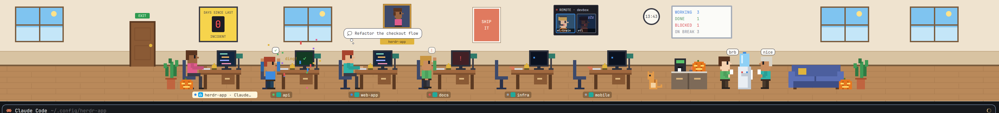

# Office

A pixel-art office strip above your terminals where every coding agent is a little coworker. Working agents type at their desks. Idle ones wander to the water cooler to chat, and nap on the couch if they stay idle. Blocked agents raise a hand. Finished ones cheer in confetti until you look. A cat lives there too. Click anyone to jump to their terminal.

## What you see

The window is Herdr's default arrangement with one strip added. From top to bottom on the right:

- **Tab bar**, 42px (Herdr's `tabs`).
- **The office**, a strip 250px tall by default (resizable from 170 to 520px).
- **The active tab's terminals**, with the Files and Changes panel on the right.
- **Status bar**, 28px.

On the left is Herdr's sidebar, with the spaces list only. The agents list is gone because the office shows the agents.

The office is drawn with flat pixel rectangles. One art unit is `P` px, where `P = clamp(floor(strip height / 60), 3, 6)`, so the art grows when the strip is dragged taller. The floor line sits 30px above the strip's bottom edge.

- **Wall.** Cream `#efe3cf`, with a wainscot band `#d8c3a2` 9 units tall and a baseboard `#7a5c3e`. Along it run, left to right:
  - windows 120px wide, with posters every fifth slot ("SHIP IT", "LGTM", "BE KIND TO YOUR AGENTS", "push --force? no.")
  - a yellow **DAYS SINCE LAST INCIDENT** sign
  - an **EMPLOYEE OF THE MONTH** portrait in a gold frame
  - a **REMOTE** video-call screen (only when agents run on another machine)
  - a round wall clock showing the real time
  - a whiteboard counting WORKING, DONE, BLOCKED and ON BREAK, plus NAPPING, INTERNS and PIZZA!! when they apply
- **Floor.** Wood `#b9895a` with plank lines `#a5784d`.
- **Room layout**, left to right and centered in the strip:
  - a brown **door** with a green EXIT sign
  - a plant
  - a row of **desks**, 48 units apart
  - the kitchen: a counter with a coffee machine, a water cooler, and a blue couch
  - another plant
- **Desks.** At least 3. Past 6 agents, a second row appears half a slot over and 10 units further back. Each desk has:
  - a chair, a monitor, a keyboard and a lamp
  - a mug colored by the agent's program: Claude `#d97757`, Codex `#e8e8e8`, Gemini `#4f86f7`, Cursor `#2b2b2b`, OpenCode `#58b368`, Amp `#9b6bdc`
  - a gold desk bell
  - a yellow sticky note on the monitor with the pane's git branch
  - a nameplate below with a status dot, the space's color tile, and "space · tab"
- **People.** Each has a stable shirt, hair, skin and pants color derived from their terminal address.
- **The window sky** follows the hour: dawn, day, sunset, and night with stars and a moon.

## How it behaves

- **working.** Sits at their desk typing (the forearm bobs). Colored code lines grow and shrink on a dark blue screen.
- **idle.** Gets up and walks to the water cooler, holding a cup. Speech bubbles cycle through small talk ("lgtm", "standup?", "🍩", "tabs > spaces"…). Their empty monitor shows a drifting screensaver dot.
  - **Napping.** After 10 minutes idle, they move to the couch (up to 3 at a time) with eyes closed and "zZz".
- **blocked.** Stands at the desk with one hand up and a blinking "!" bubble. The screen turns red with a "!".
  - **Fire alarm.** After 5 minutes blocked, a red light spins over that desk, the whole room pulses red, and the agent waves both arms yelling "HELP!!".
- **done.** Hops with both arms up and a ✓ bubble. The screen turns green, the desk bell wiggles with "ding!", and confetti falls over the desk until you look. Then the agent turns idle and walks to the cooler.
- **Walking.** Walkers slide between spots at 0.16 px/ms with swinging legs, facing the way they move.
- **Arrivals and departures.** A new agent walks in through the door to its desk. A closed agent walks out carrying a cardboard box with a plant in it. The door shows open while someone passes through.
- **Interns.** Sub-agents (terminals an agent started with `hc run`) sit on stools in front of their parent's desk at about 70% scale, typing on laptops while working. Up to 3 show, then "+N". A finished intern stands, bows with "🎓 thx!", and walks out the door. Clicking an intern peeks at its terminal.
- **Remote agents.** Agents whose address has a machine prefix (`devbox/t3`) never come into the office. They appear as tiles on the REMOTE video call, wearing headsets:
  - blue border and head bob while working
  - red flashing "!" when blocked
  - green ✓ when done
  - dimmed with "zZz" when idle

  Clicking a tile goes to their terminal.
- **Overtime.** After 30 minutes of nonstop work, sweat drops fall from the head. After an hour, a stack of mugs appears on the desk.
- **Hover.** Hovering a person shows a 💭 thought cloud with their terminal title.
- **Click.** Clicking a person or their desk focuses their pane. The focused agent's nameplate turns cream.
- **Pizza party.** When 3 agents finish within 5 minutes, a courier in a red cap walks in with a pizza, leaves it on the counter and walks out. For 8 minutes, idle agents gather around the counter saying "🍕 nom", and nobody naps.
- **Incident sign.** Resets to a blinking red 0 whenever any agent is blocked, and counts days since otherwise. It's saved across restarts.
- **Employee of the Month.** The agent with the most completed turns.
- **The cat.** About every 9 seconds it may pick a new spot: it wanders the floor and sits, or jumps onto an empty desk's keyboard to nap ("zzz"). It hops off when that agent comes back.
- **Night** (8pm to 6am). The room dims, lamps glow on occupied desks, and busy monitors light up.
- **Seasons**, by date:
  - Oct 1 to Nov 7: jack-o'-lanterns by the door, the counter and the couch
  - December: a decorated tree and blinking string lights, with snow in the windows when weather is off
  - Dec 31 to Jan 2: a HAPPY NEW YEAR banner
  - Feb 14: a Valentine's banner
- **Weather** (off by default). The windows show rain, snow, clouds, fog or a storm, refreshed every 30 minutes.
- **`ctrl-shift-i`** hides or shows the office strip (only while this layout is shown).

## Built from

- **`layouts/office.json`.** Herdr's `main` tree with:
  - the `agents` block removed from the sidebar
  - a block `{ "id": "office", "size": { "px": 250 }, "min": 170, "max": 520, "content": { "mod": "office" } }` between `tabs` and `work-body`

  The shipped mods it uses are `workspace-chrome`, `spaces`, `tabs`, `files`, `changes` and `workspace-status`.
- **`mods/office/main.js`.** The scene and all behavior. It reads:
  - `agents()` for status, title, space, tab and pane
  - `terminals()` for sub-agents via `parent`, plus `turn` and `state`
  - `spaces()` for each tab's `changed_at` and `working_since`
  - `panes()` for branches
  - `shared("space.icons")` and `shared("space.colors")` for nameplate tiles

  It calls `setAgentOrder`, and runs `pane.focus` and `terminal.peek`. Motion is native only: `transition("left"/"top")` for walking, `loop` for typing, bobbing, legs and confetti, and `frames` for speech bubbles. Timers handle data only: the clock (30s), the cat (9s), walk arrivals, the party end, and weather (30min).
- **`mods/office/art.js`.** Every sprite as `[x, y, w, h, color]` rect lists (y counts up from the floor), the palette, and `look(address)`.
- **`mods/office/decor.js`.** Windows with weather, posters, clock, whiteboard, incident sign, portrait, video call, door, string lights, banners and the alarm.
- **`keys.json`.** `"layout:office": { "ctrl-shift-i": "layout.toggle:office" }`.
- **Network** (only when `WEATHER = true` in `main.js`): `https://ipapi.co/json/` once, for a rough location from your IP, then `https://api.open-meteo.com/v1/forecast?...&current=weather_code` every 30 minutes. Nothing else leaves the machine. It runs no programs.

## Watch out

- `herdr-app check` renders with no agents, so it can't catch errors in per-agent drawing. Try it with real agents running. An early build crashed on a negative palette index from a signed XOR in the hash.
- `P` is a live `export let` in `art.js`, set by the scene before drawing. Anything that sizes art must read it after `setScale`.
- Walks need stable element ids (`person-<address>`, `cat`, `courier`) so `transition` animates between renders.
- Herdr only draws while its window is visible, so `herdr-app shot` returns the last frame when the window is hidden.
- When the mod reloads, everyone already present appears in place instead of walking in, and nap and alarm timers restart from each tab's `changed_at`.
- Remote agents are detected by a `/` in their address. Their sub-agents aren't drawn.
- The back row partly overlaps the front row, and back-row nameplates sit above the monitors.
- Nameplate icon tiles only show custom icons if something writes `shared("space.icons")` (`{ [spaceId]: { svg } | { text } }`). Otherwise they show the space color.

## Done when

- A working agent sits typing at a desk with moving code lines, and its nameplate shows its space and tab.
- Making an agent idle walks it to the water cooler with a cup and a cycling speech bubble.
- A blocked agent raises a hand with a red "!" screen, and the incident sign shows a blinking red 0.
- A finished agent hops in confetti with "ding!" until its terminal is viewed.
- Running `hc run --bg -- sleep 20` from an agent's terminal puts an intern on a stool at its desk. When it exits, the intern bows "🎓 thx!" and leaves through the door, which opens.
- Starting a new agent shows it walking in from the door. Closing one shows it leaving with a box.
- An agent on another machine appears only on the REMOTE call, with a border matching its status.
- Hovering a person shows their terminal title in a thought cloud.
- `ctrl-shift-i` hides and shows the strip.
